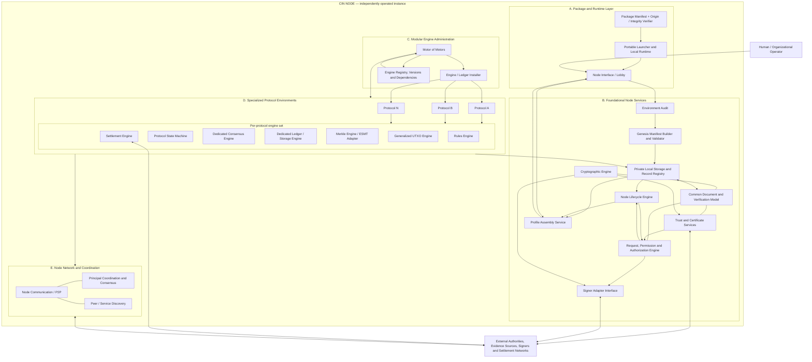
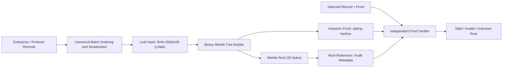
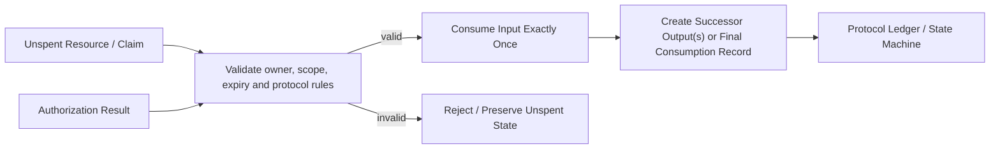
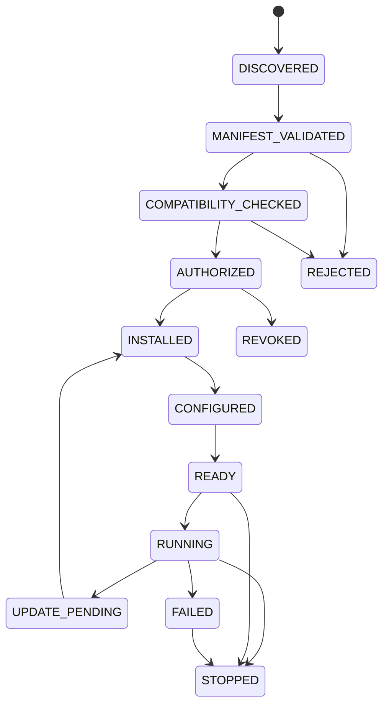
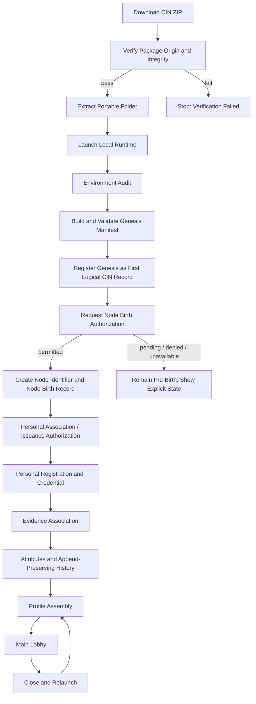

# CIN — Master Architecture v1.0
## Core Identification Nodes byLAEV
### System architecture, engines, layers, dependencies and authorization flows

**Document class:** Master architectural specification — conceptual baseline  
**Version:** 1.0  
**Status:** Proposed / submitted for architectural review  
**Original conception and architectural design:** LAEV  
**Repository:** `LerryAlexanderElizondoVillalobos/CIN-Core-Identification-Nodes-byLAEV`  
**Date:** 2026-11-17

---

## 1. Executive architectural statement

Core Identification Nodes (CIN) is a proposed decentralized, modular infrastructure for independently operated nodes and multiple specialized technological ecosystems.

CIN is not designed as one universal application-chain. Its defining architectural decision is to provide a shared foundational environment while allowing specialized protocols to retain their own ledgers, consensus mechanisms, state machines, execution engines and settlement configurations.

**CIN is an infrastructure for hosting, administering and connecting independent infrastructures.**

The architecture is organized around five structural ideas:

1. **Independent nodes:** people and organizations operate their own node instances.
2. **Shared foundational services:** common runtime, communications, cryptographic, trust, storage and coordination capabilities.
3. **Modular engine administration:** a Motor of Motors manages the lifecycle of installable engines and specialized components.
4. **Protocol autonomy:** each application protocol defines its own ledger, state machine, rules and consensus.
5. **Explicit authority boundaries:** evidence verification, trust, authorization, signing, resource consumption and settlement remain separate responsibilities.

This document consolidates the original CIN architectural vision with the current repository architecture baseline and the ESMT proposal supplied for this project. It does not claim that every component is implemented or production-ready.

## 2. Scope, authority and maturity notation

This document describes the target architecture. The repository's implementation status remains governed by code, tests, reviewed specifications and recorded acceptance evidence.

Use these maturity labels throughout the document:

- **[CONCEPT]** Original architectural concept; not yet a complete technical contract.
- **[SPECIFIED]** A written contract or specification exists; implementation may still be pending.
- **[PROTOTYPE]** An initial implementation exists, but scope and validation are limited.
- **[IMPLEMENTED]** Code exists for the stated scope.
- **[TESTED]** Tests demonstrate the stated behavior.
- **[INTEGRATED]** The component has been validated with its required dependencies.
- **[FUTURE]** A planned subsystem or extension.

A component must not be described as operational merely because it appears in a diagram, README, proposal or roadmap.

### 2.1. Current known repository boundary

At the current documentation baseline, the repository contains architecture and lifecycle specifications, a proposed dependency map, storage and package-verification documentation, and a Linux portable prototype with local storage work. The first complete CIN lifecycle through a reconstructed Main Lobby is not yet established as production functionality.

The following broader systems remain architectural targets unless separately demonstrated by implementation and tests:

- Network-wide peer communication and consensus.
- Production Motor of Motors.
- Production installation and operation of specialized Ledgers.
- Full certificate and authorization governance.
- External hardware signing interoperability.
- Production ESMT service.
- Generalized UTXO engine.
- Monetary settlement integrations.
- Global personal-number uniqueness coordination.

## 3. Architectural vocabulary

| Term | Meaning |
|---|---|
| Node | Independently operated CIN software instance and its local operational state |
| Operator | Person or organization administering a node |
| Foundational infrastructure | Shared services used by the node and installed protocols |
| Engine | A bounded functional component with a defined contract |
| Motor of Motors (MoM) | Engine administration and lifecycle coordination layer |
| Specialized protocol | Application-specific rules and execution environment |
| Ledger | Protocol-specific record/state system |
| State machine | Explicit model of permitted states and transitions |
| Trust | Policy decision about an issuer, key, source or authority for a stated purpose |
| Authorization | Permission for a particular operation within a defined scope |
| Signer | External or integrated component that performs a cryptographic signing operation |
| ESMT | Enterprise Merkle Tree proposal for deterministic batch commitments and inclusion proofs |
| Generalized UTXO | Proposed functional model for uniquely consumable resources, permissions or entitlements |
| Settlement | Completion of a monetary or asset transfer through a selected external or native mechanism |

**Important separation:** cryptographic integrity, signature validity, issuer trust, factual evidence verification and operation authorization are different outcomes. A valid hash or signature must not be treated as proof of all the others.

## 4. System context

CIN has three broad operational actors:

- **Node operator:** configures and operates an individual CIN node.
- **External authorities and services:** may issue certificates, authorize operations, provide evidence, sign requests or settle transactions.
- **Specialized applications and their participants:** use protocol-specific engines and Ledgers hosted or coordinated through CIN.

The foundational infrastructure provides shared capabilities; it does not automatically control every application's data or operational rules.

## 5. Master system diagram

The following diagram shows the target architecture at a logical level. Boxes are architectural responsibilities, not claims that each service is already a separate executable or deployed process.



### 5.1. Diagram interpretation

- The package/runtime layer gets a node process running from a verified portable package. Package verification is not node birth.
- Foundational services manage local records, lifecycle, trust, authorization and cryptographic operations.
- Motor of Motors administers the installation and lifecycle of engines. It does not replace the internal rules or execution logic of every installed protocol.
- Specialized protocols use dedicated engine sets. They may share infrastructure interfaces without sharing application state or consensus rules.
- Network and coordination capabilities are foundational targets, but the current local prototype must not be confused with a completed decentralized network.
- External systems remain explicit boundaries: issuers, authorities, signers, evidence sources and settlement networks are not automatically trusted merely because they are connected.

## 6. Architectural layers and responsibilities

### Layer A — Package, bootstrap and local runtime

**Purpose:** deliver a portable CIN application that can be verified, extracted and executed locally.

Components:
- Package Manifest.
- Package Origin and Integrity Verifier.
- Portable ZIP extraction contract.
- Launcher and runtime.
- Runtime diagnostics and configuration.

Invariants:
- A verified archive is not a born node.
- Extraction is not formal installation into the operating system.
- The portable-folder execution model remains the governing product requirement.
- Package publisher trust and archive integrity must be reported separately.

**Maturity:** package and runtime architecture specified; Linux prototype exists; complete cross-platform acceptance remains pending.

### Layer B — Foundational node services

This layer contains the minimum services required to prepare, register and operate a node.

#### B1. Environment Audit Engine [CONCEPT / SPECIFICATION IN PROGRESS]
Collects technically accessible environment observations and operator declarations with provenance. It must preserve distinctions such as observed, declared, derived, unavailable and not collected.

#### B2. Genesis Manifest Builder [SPECIFIED AT ARCHITECTURAL LEVEL]
Builds and validates the pre-birth manifest from the audit and declared configuration. The Genesis Manifest is intended to be the first logical CIN record in private local storage.

#### B3. Private Local Storage [PROTOTYPE / LIMITED TEST EVIDENCE]
Persists authoritative records, referenced objects, transaction journals and commit markers. Indexes and Lobby projections are derived and rebuildable. The first logical CIN record is the Genesis Manifest; storage-internal metadata does not count as a logical application record.

#### B4. Node Lifecycle Engine [SPECIFIED AT ARCHITECTURAL LEVEL]
Separates package verification, extraction, audit, Genesis registration, birth authorization, node birth, human association, credential issuance and Lobby activation.

#### B5. Common Document and Verification Model [SPECIFIED AT ARCHITECTURAL LEVEL]
Defines document type, ID, version, canonical content, digest, issuer/key references, timestamps, subject and record references, status and schema. Verification results distinguish schema validity, integrity, signature, issuer trust, authorization and revocation/expiry.

#### B6. Trust and Certificate Services [CONCEPT / SPECIFICATION REQUIRED]
Manages trust anchors, issuer profiles, certificate installation, verification, expiry, rotation and revocation. Package-signing trust and CIN document-issuer trust are separate purposes.

#### B7. Request, Permission and Authorization Engine [CONCEPT / SPECIFICATION REQUIRED]
Receives an operation request and evaluates subject, action, resource, scope, context, policy, authority and required evidence. Produces an explicit decision and, where applicable, a durable authorization record.

#### B8. Signer Adapter Interface [CONCEPT / INTERFACE REQUIRED]
Connects CIN to a signer without requiring production private keys to be embedded in the portable package. Possible implementations include USB hardware, external signing services or local plugins. The authorization engine determines whether a signature is required; the signer performs the cryptographic operation.

#### B9. Cryptographic Engine [CONCEPT / SPECIFICATION REQUIRED]
Provides hashing, signature verification, cryptographic authentication and other common primitives. Algorithms and serialization profiles must be versioned and tested.

#### B10. Profile Assembly Service [CONCEPT]
Builds a read model from authoritative persisted records and verification outcomes. The Main Lobby presents this projection; it is not itself an authority or record issuer.

### Layer C — Motor of Motors and component installation

**Motor of Motors (MoM)** is the management plane for installable engines and specialized components.

Responsibilities:
- Maintain an engine catalog and registry.
- Check engine package metadata and integrity.
- Manage compatibility, versions and declared dependencies.
- Install and configure authorized engines.
- Coordinate updates and lifecycle status.
- Expose installed/available/configured/running/failed states accurately.

The **Engine / Ledger Installer** is a managed function within this plane. Installation of a component does not mean it is trusted, configured or operational. Those are separate lifecycle states.

MoM must not silently impose one protocol's rules on another protocol.

### Layer D — Specialized protocols and Ledgers

Each specialized protocol is an independent functional environment. Its engine set may include:

- Rules Engine.
- Protocol State Machine.
- Dedicated Consensus Engine.
- Dedicated Ledger / Storage Engine.
- Functional Execution Engines.
- Merkle / ESMT Engine or adapter.
- Generalized UTXO Engine.
- Settlement Engine.

A protocol can install only the engines it requires. A voting protocol, legal-contract protocol, auction protocol and poker-related protocol need not share identical states or consensus.

**Autonomy rule:** shared CIN infrastructure does not imply shared protocol state, unrestricted data access or automatic interoperability.

### Layer E — Node networking and coordination

The target architecture includes:
- Node-to-node communication.
- Peer and service discovery.
- Synchronization interfaces.
- Principal coordination and consensus services.
- Explicit interfaces for specialized protocol networking.

The principal coordination layer is distinct from each application's dedicated consensus engine. The exact consensus, membership, governance, conflict-resolution and network-admission rules remain to be specified and validated.

### Layer F — External integrations

CIN may integrate with:
- Institutional evidence sources.
- Certificate and authorization authorities.
- External signing devices and services.
- Blockchain networks and digital-asset systems.
- Fiat payment or settlement systems.
- Enterprise systems through APIs.

An integration is an adapter boundary, not an automatic trust relationship. Each integration requires its own protocol, data contract, verification and authorization policy.

## 7. Core engines — functional catalogue

| Engine / service | Primary input | Primary output | Authority boundary |
|---|---|---|---|
| Package Verifier | ZIP, manifest, signature, trust configuration | Integrity, signature, publisher trust and metadata results | Does not authorize node birth |
| Environment Auditor | Host observations and declarations | Provenance-aware audit | Does not certify personal attributes |
| Genesis Builder | Audit + declarations + schema | Genesis Manifest candidate | Does not create birth event |
| Storage Engine | Valid record and transaction request | Durable committed record/reference | Storage commit is not external trust |
| Lifecycle Engine | Current state + event | Validated state transition | Cannot invent authorization |
| Document Verifier | Document + schema + references | Structured verification report | Integrity, signature and issuer trust remain separate |
| Trust / Certificate Engine | Issuer/key/certificate material | Trust decision and certificate state | Trust is purpose-specific |
| Authorization Engine | Request + policy + authority context | Permit / deny / pending / unavailable | Does not perform the signature itself |
| Signer Adapter | Authorized signing request | Signature and signer result | Cannot broaden the authorization scope |
| Motor of Motors | Engine manifest + compatibility policy | Install/update/lifecycle result | Does not execute application business rules |
| Ledger Installer | Authorized engine package | Installed Ledger environment | Installation is not activation or consensus |
| Rules Engine | Protocol event + rule set | Rule evaluation | Protocol-local |
| State Machine | Current state + event + authorization result | Accepted/rejected transition | Protocol-local |
| Consensus Engine | Protocol proposals and validation messages | Protocol agreement/finality result | Protocol-local |
| Merkle / ESMT Engine | Canonical batch records | Merkle root and inclusion proof | Commitment does not prove source truth |
| Generalized UTXO Engine | Unspent resource/claim + consume request | Consumed state and successor outputs | Functional resource model, not inherently money |
| Settlement Engine | Authorized settlement instruction | Settlement status/reference | External settlement finality is separately verified |
| Profile Assembly | Persisted records + verifier outcomes | Rebuildable Lobby read model | Projection is not authoritative |

## 8. Trust, permission and signing architecture

### 8.1. Three decisions, three records

CIN must distinguish:

1. **Evidence verification:** what does the evidence establish, who issued it, and what is its current verification status?
2. **Trust decision:** is the issuer/key/source trusted for this purpose and at this time?
3. **Operation authorization:** may this subject perform this specific operation under the defined policy and scope?

A fourth, separate operation may be required:

4. **Cryptographic signing:** can the authorized signer sign the exact payload or digest requested?

A successful signature does not retroactively create permission. A permission does not prove the signature was produced. A cryptographically intact record does not prove its assertions are factually true.

### 8.2. Authorization request model

A canonical request should define at least:

- Request ID and schema version.
- Requesting node / subject reference.
- Requested action.
- Target resource or record reference.
- Scope and constraints.
- Relevant protocol and operation context.
- Required evidence references.
- Required signature profile, if any.
- Issuing authority or policy reference.
- Creation time, expiry and nonce/idempotency reference.
- Current decision status and decision evidence.

The exact field names and serialization belong in a versioned authorization specification.

### 8.3. Authorization decision states

At minimum, the engine should represent:
- `PERMITTED`
- `DENIED`
- `PENDING_AUTHORITY`
- `UNAVAILABLE`
- `EXPIRED`
- `REVOKED`
- `INVALID_REQUEST`

Do not convert unavailable authority into approval. Do not treat a pending request as a denial or as a completed operation.

### 8.4. Authorization and signing sequence

```mermaid
sequenceDiagram
  autonumber
  actor Operator
  participant App as CIN App / Protocol
  participant Auth as Request & Authorization Engine
  participant Trust as Trust / Certificate Service
  participant Authority as External Authority / Policy
  participant Signer as External Signer
  participant Store as CIN Storage
  participant Engine as Target Functional Engine

  Operator->>App: Request operation
  App->>Auth: Submit operation + scope + payload reference
  Auth->>Trust: Validate issuer, credentials and trust context
  Trust-->>Auth: Trust / certificate verification result
  Auth->>Authority: Request or evaluate scoped permission
  Authority-->>Auth: Permit / deny / pending / unavailable
  alt Decision is PERMITTED and signature is required
    Auth->>Store: Persist authorization decision / request reference
    Auth->>Signer: Sign exact authorized payload or digest
    Signer-->>Auth: Signature + signer metadata
    Auth->>Trust: Verify signature and signer certificate
    Trust-->>Auth: Signature and trust result
    Auth->>Engine: Authorized operation + verified signature
    Engine->>Store: Commit operation record and state change
    Store-->>Engine: Commit result
    Engine-->>App: Operation result
    App-->>Operator: Display result and evidence
  else Denied / pending / unavailable / invalid
    Auth-->>App: No execution; return explicit decision state
    App-->>Operator: Explain required next step
  end
```

**Invariant:** the target engine executes only after the required authorization checks have succeeded and any required signature has been verified against the exact authorized payload. If a protocol defines a different signing order, that order must be explicit in its operation contract.

### 8.5. Example: node birth and personal issuance

Node birth and personal registration are distinct operations.

- Birth authorization applies to the creation of a Node Birth Record referencing a registered Genesis Manifest.
- Personal issuance authorization applies to the separate association/registration process for a person and a born node.
- A born node does not imply a person has been registered.
- A personal credential does not itself prove global uniqueness unless a defined allocation/coordination mechanism supports that claim.

## 9. ESMT and Merkle engine placement

The uploaded ESMT proposal describes a deterministic binary Merkle construction for enterprise audit batches, with SHA-256, leaf/internal-node domain separation, canonical input ordering, a Merkle Root, and (O(\log n)) inclusion proofs.

The proposed hash definitions are:

```text
LeafHash     = SHA-256(0x00 || record_bytes)
InternalHash = SHA-256(0x01 || left_hash || right_hash)
```

The proposal describes controlled duplication of the last node at an odd-width level. This rule must be fixed normatively in the ESMT specification and accompanied by test vectors before interoperability is claimed. The proposal references RFC 6962-style domain separation; the exact tree-shape and inclusion-proof profile must be documented as the ESMT profile rather than assuming every RFC 6962 behavior follows automatically.

### 9.1. ESMT functional pipeline



### 9.2. ESMT as a CIN service

ESMT belongs in the cryptographic/data-integrity service family and can be exposed to specialized protocols through a stable adapter/API.

The uploaded commercial proposal describes a decoupled microservice integration using REST/JSON, container deployment options, batch roots and on-demand proof retrieval. These are deployment proposals, not evidence of a production service in the CIN repository.

Illustrative integration responsibilities:
- Protocol supplies a canonical batch and its context.
- ESMT validates batch schema/order and computes the root.
- Protocol stores the root reference and batch metadata in its own Ledger or authorized storage.
- ESMT returns inclusion proofs for selected records.
- An independent verifier recomputes the path and compares it to the authenticated root reference.

An ESMT root commits to the bytes processed under the profile. It does not independently prove that the original records were truthful, complete, authorized or issued by a trusted source.

### 9.3. Required ESMT specification work

- Canonical record encoding and ordering.
- Exact odd-node and tree-shape rule.
- Empty-batch behavior.
- Duplicate-record behavior.
- Batch ID, version and timestamp semantics.
- Proof serialization and direction metadata.
- Root authentication/anchoring policy.
- Positive and negative test vectors.
- Cross-language interoperability tests.
- Performance benchmarks with stated hardware and batch distributions.

## 10. Generalized UTXO engine placement

The generalized UTXO proposal applies the functional idea of uniquely consumable outputs to resources or claims beyond monetary value.

Potential resources:
- One-time permissions.
- Resource allocations.
- Execution rights.
- Digital entitlements.
- Application-specific claims.
- Single-use authorizations.

A generalized UTXO operation should identify the input resource/claim, validate its current unspent status, validate authorization and protocol rules, consume the input exactly once, and create any permitted successor outputs.



This is a functional resource model, not automatically a currency. The engine must define double-consumption prevention, concurrency semantics, expiration, revocation, splitting/merging rules (if supported), and recovery behavior.

## 11. Motor of Motors lifecycle

A managed engine should move through explicit states:



These are proposed lifecycle states. The component manifest, dependency semantics, update compatibility, rollback behavior and authorization policy must be specified before production use.

## 12. Protocol autonomy and interoperability

A specialized protocol owns:
- Its business rules.
- Its state machine.
- Its consensus mechanism.
- Its Ledger and data schema.
- Its engine configuration.
- Its permission policy.
- Its settlement selection.

CIN shared services may provide networking, cryptographic primitives, engine installation, trust interfaces and resource management. They do not automatically grant one protocol access to another protocol's records.

Cross-protocol interaction must use an explicit interface that defines:
- Data exchanged.
- Message or event schema.
- Authentication and trust requirements.
- Authorization requirements.
- Replay/idempotency behavior.
- Error and timeout semantics.
- Settlement/finality assumptions, where applicable.

## 13. Data authority and record lifecycle

The storage model distinguishes:
- **Authoritative records:** Genesis Manifest, Node Birth Record, registration, credential, evidence, authorization and attribute events.
- **Referenced objects:** content addressed by digest and verified when read.
- **Transaction evidence:** journals, staging and commit markers required for durable operations.
- **Derived indexes:** rebuildable from authoritative records.
- **Projections:** profile and Lobby read models, rebuildable from source records.

The Profile Assembly Service must not become the source of truth. It resolves references and verifier results into a user-facing projection.

A record is not considered committed merely because a file was written. The storage contract must define staging, digest calculation, publication, commit marker, idempotency and recovery. Current storage prototype limitations must remain explicit in implementation documentation.

## 14. Main Lobby and node lifecycle

The target lifecycle is:



Human association, credentials, evidence and profile attributes remain separate records and operations. The Main Lobby must reflect the actual lifecycle and verification states.

## 15. Security and trust boundaries

This architecture records functional boundaries, not a claim that all security controls are already implemented.

Required boundaries include:
- Package publisher trust vs. document issuer trust.
- Local operator permissions vs. external authority decisions.
- Private-key custody vs. signature request orchestration.
- Record integrity vs. truth of record content.
- Protocol isolation vs. explicit interoperability.
- Authorization decision vs. execution.
- Local node birth vs. network admission.
- UTXO resource consumption vs. monetary settlement.
- Merkle commitment vs. trusted root publication.

Security controls should be prioritized after each functional contract is implemented and its actual risks can be evaluated, without compromising the foundational behavior.

## 16. Implementation sequencing and dependency gates

| Sequence | Workstream | Prerequisite | Exit evidence |
|---:|---|---|---|
| M0 | Architecture baseline and component contracts | Current repository inventory | Reviewed baseline, dependency map and decision register |
| M1 | Portable bootstrap | Runtime decision and package contract | Clean ZIP extraction, launch and origin/integrity checks |
| M2 | Environment audit and Genesis | Runtime + audit/manifest schemas | Deterministic manifest and first logical record |
| M3 | Private local storage | Storage contract | Commit, restart, recovery and integrity tests |
| M4 | Trust and certificates | Common document and trust model | Issuer/key verification and lifecycle tests |
| M5 | Node birth | Genesis + storage + authorization | Valid Node Identifier and Birth Record |
| M6 | Personal registration | Birth + issuance authority | Explicit person-node association and credential |
| M7 | Evidence association | Document/trust model | Evidence references with honest verification states |
| M8 | Attributes and history | Registration + evidence + storage | Versioned profile and append-preserving history |
| M9 | Main Lobby | Profile Assembly Service | Lobby rebuilt from persisted records |
| M10 | End-to-end validation | All prior gates | ZIP-to-Lobby, restart, integrity and recovery acceptance |

Parallel design work may define future interfaces for MoM, ESMT, generalized UTXO, protocol Ledgers and networking. Their production implementation must not be represented as complete until independently tested.

## 17. Open architectural decisions

The following items require explicit decisions and must not be silently assumed:
1. Runtime and UI stack for the portable package.
2. User data root location and behavior when the extracted folder is moved or replaced.
3. Supported operating systems and packaging matrix.
4. CIN trust-anchor governance and issuer lifecycle.
5. Canonical serialization and signature profile for common records.
6. Authority model and offline behavior for birth and personal issuance.
7. Global uniqueness coordination for personal numbers.
8. External signer API and supported USB hardware.
9. Protocol installation manifest and dependency resolution.
10. Principal coordination and consensus model.
11. Cross-protocol interoperability and settlement semantics.
12. Normative ESMT tree-shape, proof format and test vectors.
13. Generalized UTXO concurrency, expiry, revocation and successor rules.

Each decision should be recorded in an ADR or versioned specification with rationale and acceptance evidence.

## 18. Glossary and architectural invariants

- A package is not a node birth.
- A Genesis Manifest is not a Node Birth Record.
- A born node is not automatically associated with a person.
- Personal registration is not global uniqueness unless the allocation model proves it.
- A signature is not an authorization decision.
- A trusted issuer is not the same as a valid hash.
- A Merkle root is not proof that source data is true.
- Installing an engine is not the same as configuring or running it.
- A protocol Ledger is not the same as the CIN foundational store.
- Generalized UTXO consumption is not necessarily a monetary transaction.
- A Main Lobby projection is not an authoritative record.
- Shared infrastructure does not mean all protocols share consensus or state.

## 19. Source documents and traceability

This master document consolidates and must remain consistent with:

- [CIN Architecture Baseline v1](CIN_ARCHITECTURE_BASELINE_V1.md)
- [CIN Component Dependency Map](CIN_COMPONENT_DEPENDENCY_MAP.md)
- [Node Lifecycle Architecture](NODE_LIFECYCLE_ARCHITECTURE.md)
- [Genesis Preparation Architecture](GENESIS_PREPARATION_ARCHITECTURE.md)
- [Package Origin Verification](PACKAGE_ORIGIN_VERIFICATION.md)
- [CIN Record Storage Layout](CIN_RECORD_STORAGE_LAYOUT.md)
- [Original CIN architecture diagram](../assets/cin-original-architecture.png)
- [ESMT commercial and technical proposal — uploaded project source]
- [ESMT interactive technical proposal — uploaded project source]

The ESMT source proposal is the basis for the stated SHA-256, domain-separated leaf/internal hashes, canonical batch ordering, odd-level duplication proposal, inclusion proofs, REST/JSON microservice integration and six-week commercial pilot outline. These remain an ESMT proposal until normative specifications, test vectors, implementation and benchmarks are completed.

## 20. Authorship

**Core Identification Nodes (CIN)**  
Original conception, architectural design and independent development direction: **LAEV**.

This document describes the target architecture. Future code contributions, technical reviews, integrations and independent implementations must be attributed according to their actual participation.

---

*End of CIN Master Architecture v1.0.*
