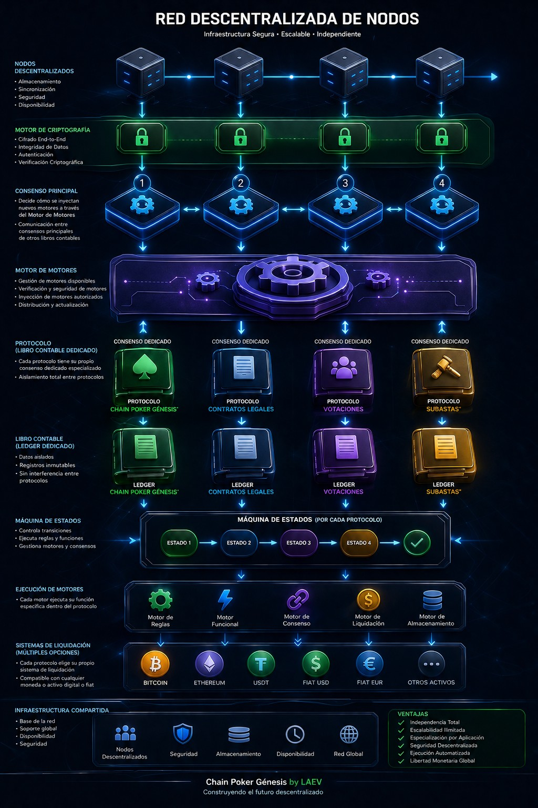

# CORE IDENTIFICATION NODES (CIN)

## byLAEV — Decentralized Infrastructure Architecture

**An Independent Technological Architecture for Human-Operated Nodes, Specialized Blockchains, Distributed Ledgers and Modular Digital Ecosystems.**

  <strong>Original conception, architectural design and independent development by LAEV</strong>

---

## 1. Introduction

**Core Identification Nodes (CIN)** is an independently conceived, designed and developed proposal for a decentralized technological infrastructure intended to connect individually operated nodes, verifiable human and organizational participation, specialized blockchain networks, dedicated distributed ledgers, modular applications and independent monetary settlement systems.

CIN proposes an architecture in which individuals and public or private organizations can operate and administer nodes within a distributed network. These participants can present evidence supporting their registration and verification, establish operational reputations, and obtain access to specialized technological infrastructures according to defined permissions and verification requirements.

Rather than relying on a single blockchain, a universal consensus mechanism or one application-specific environment, CIN envisions a modular ecosystem capable of hosting multiple independent protocols, each with dedicated operational rules, consensus mechanisms, ledgers, state machines and execution engines.

The central architectural objective is to establish a common decentralized infrastructure upon which specialized technological ecosystems can operate independently while sharing essential network services.

CIN is not conceived as a Bitcoin implementation or as a blockchain dependent on Bitcoin. It is an independent architectural proposal that explores the use of decentralized networking, cryptographic verification, binary Merkle trees and generalized UTXO-based functional structures as components of a broader infrastructure.

## 2. Project Origin and Original Authorship

Core Identification Nodes originates from the independent research, conceptual development, architectural design and technological experimentation of:

**Lerry Alexander Elizondo Villalobos**

- **Professional name:** LAEV
- **GitHub identity:** byLAEV
- **Founder and original author:** Core Identification Nodes
- **Founder:** Trilema Records
- **Development methodology:** Independent and autodidactic research and development.

CIN has been conceived, designed, documented and developed exclusively by LAEV.

The project's original architectural concepts, development direction, documentation and implementation efforts are the work of one individual. No human co-authors or human development collaborators have participated in its original conception or development.

LAEV's technological experience is autodidactic and results from independent exploration and experimentation across multiple disciplines, including architecture, digital design, animation, Bitcoin, blockchain technology, peer-to-peer electronic money, decentralized finance, cryptography and electronic ecosystems.

His work is guided by an individual professional philosophy and design methodology that emphasizes independently defining architectural structures, developing original functional concepts and attempting to demonstrate their feasibility through practical implementation.

LAEV also founded **Trilema Records**, an independent music label focused on thematic musical projects connected to technology, Bitcoin, blockchain, decentralized ecosystems and related subjects.

CIN represents the integration and continued development of this independent technological research trajectory.

## 3. The Fundamental Vision

The fundamental idea behind CIN is that decentralized infrastructure should be capable of supporting more than the operation of a single blockchain or the execution of a single application.

It should provide an environment in which multiple specialized technological systems can coexist, operate and evolve through a shared network of independently administered nodes.

The proposed architecture establishes a distinction between:

**Shared infrastructure**

The foundational network responsible for node connectivity, communication, cryptographic services, coordination, resource management and common operational capabilities.

**Specialized infrastructures**

Independent protocols and applications that operate using their own dedicated consensus mechanisms, ledgers, state machines, execution engines and settlement configurations.

This separation is intended to allow each application to maintain its own functional rules and operational structure without requiring all participating applications to operate under one universal protocol.

The network becomes an infrastructure for multiple technological ecosystems rather than a single-purpose blockchain.

## 3.1. Master Architecture

The consolidated system architecture, including its layers, engines, dependencies, authorization and signing flows, ESMT placement, generalized UTXO model, and implementation maturity boundaries, is documented in:

- [CIN — Master Architecture v1.0](docs/architecture/CIN_MASTER_ARCHITECTURE_V1.md)
- [CIN — Enterprise Identification, Storage Architecture and Private Folder](docs/architecture/CIN_ENTERPRISE_IDENTIFICATION_AND_PRIVATE_STORAGE.md)

This document is the architectural overview for the target CIN system. It distinguishes conceptual subsystems from specifications, prototypes and validated implementations.

---

## 3.2. Development Roadmap

CIN follows a five-phase development plan, separating the foundational personal identification infrastructure from the basic network engines, decentralized registration engines, specialized applications and later economic, social and civilizational expansion.

- **Phase 1 — Worldwide CIN Personal Identification Infrastructure:** Generate the worldwide personal identification document CIN and enable the CIN Engine Manager (Motor of Motors). These are the complete foundational scope of Phase 1.
- **Phase 2 — CIN Basic Network Infrastructure:** Develop six independent installation packages: Networks, Requests & Permissions, Storage, Evidence & Proof, Cryptography and Consensus. Together, they establish the basic decentralized network infrastructure for CIN nodes.
- **Phase 3 — Decentralized Registration Infrastructure:** Develop the Ledger, UTXO and Binary Merkle Tree engines to provide decentralized records, unique-consumption resource structures and cryptographic proofs.
- **Phase 4 — Dedicated Specialized Applications:** Develop applications that use Phase 1 for CIN foundational references, Phase 2 for network verification and consensus, and Phase 3 for decentralized registration and proofs.
- **Phase 5 — Economic, Social and Civilizational Ecosystems:** Expand CIN through additional engines and applications, including Worldwide CIN Enterprise Identification Infrastructure.

The complete scope, objectives, outcomes and architectural dependencies are documented in the [CIN Development Roadmap](ROADMAP.md).

---

## 4. Original Architectural Conception

The original architectural diagram developed by LAEV illustrates the initial vision of this modular decentralized infrastructure.

*Original conceptual architecture by LAEV — Decentralized Node Network and Specialized Protocol Infrastructure.*

The diagram presents a layered system organized around decentralized nodes, cryptographic services, principal consensus, engine management, dedicated protocols, specialized ledgers, state machines, functional execution engines and multiple settlement options.

### 4.1. Decentralized Node Network

The foundational layer consists of independently operated and administered nodes.

Each node represents a network participant and provides the infrastructure required to participate in decentralized operations.

The proposed network functions include:

- Distributed connectivity.
- Data storage and synchronization.
- Node communication.
- Operational availability.
- Cryptographic services.
- Network participation and coordination.
- Access to authorized specialized infrastructures.

Nodes are intended to be operated by individuals and organizations rather than being exclusively controlled by a central infrastructure provider.

### 4.2. Human and Organizational Node Verification

A defining component of CIN is the relationship between decentralized nodes and their human or organizational operators.

The proposal introduces a verification infrastructure through which a node operator can present evidence establishing the nature and legitimacy of its participation.

Depending on the participant and applicable verification procedures, evidence may include:

- Government-issued personal identification documents.
- Nationality and relevant civil documentation.
- Evidence issued by recognized institutions.
- Organizational registration and legal documentation.
- Additional verifiable records.
- Cryptographic credentials and authorization evidence.

The intended verification process involves participating nodes evaluating submitted evidence according to defined verification rules, trusted sources and applicable requirements.

The infrastructure is designed to distinguish between individual human participants and public or private organizations.

Verification of submitted evidence, control of a network node and authorization to perform operations are separate requirements. The architecture must define how each is established and maintained.

### 4.3. Node Reputation and Participation

CIN proposes a reputation infrastructure associated with verified participation and the operational history of nodes.

Reputation can contribute to determining access permissions, eligibility for specialized applications and participation in particular protocols.

The proposed system aims to establish a relationship between:

- Verified participation.
- Node operation history.
- Authorized activities.
- Recorded behavior.
- Participation in specialized ecosystems.
- Application-specific reputation requirements.

Reputation is intended to be evaluated within defined operational contexts rather than treated as an absolute measure of the credibility of a person or organization.

### 4.4. Cryptographic Engine

The cryptographic layer provides common cryptographic capabilities for the network and its specialized systems.

Its intended functions include:

- End-to-end encryption.
- Data integrity verification.
- Cryptographic authentication.
- Digital signatures and signature verification.
- Secure communication.
- Verification of cryptographic evidence.
- Support for specialized cryptographic engines.

Cryptographic verification establishes the integrity and validity of cryptographic operations according to their defined rules. It does not independently establish the factual truth of external documents or statements.

### 4.5. Principal Consensus Infrastructure

The original conception includes a principal coordination and consensus layer.

Its proposed responsibilities include:

- Coordinating the foundational network.
- Managing the authorization of new engines.
- Supporting communication between participating nodes.
- Coordinating specialized infrastructure.
- Establishing operational rules for introducing additional components.
- Supporting communication between principal consensus mechanisms and other dedicated ledgers where explicitly configured.

This layer is conceptually distinct from the consensus mechanisms operated by individual application protocols.

CIN does not assume that every specialized application must share one universal consensus algorithm.

### 4.6. Motor of Motors — Engine Management Infrastructure

One of the defining architectural concepts in the original diagram is the **Motor of Motors**.

This component is envisioned as an infrastructure responsible for administering the lifecycle of specialized functional engines.

Its proposed capabilities include:

- Managing available engines.
- Verifying engine authorization and integrity.
- Installing authorized engines.
- Distributing engine components.
- Managing updates.
- Coordinating engine availability.
- Supporting specialized application configurations.

The objective is to establish a modular environment in which new technological functions can be introduced without requiring the entire foundational infrastructure to be redesigned.

The Motor of Motors is an architectural management concept and is subject to implementation and validation.

## 5. Dedicated Protocols and Specialized Ledgers

CIN proposes that different applications and technological ecosystems operate through dedicated protocols.

Each protocol can contain its own operational rules, consensus mechanism, distributed ledger, state machine and functional execution engines.

The original diagram illustrates four examples:

| Specialized protocol | Intended application |
|---|---|
| Chain Poker Génesis | Poker-related decentralized application and records |
| Legal Contracts | Legal agreements and associated records |
| Voting | Voting and governance processes |
| Auctions | Auction and bidding processes |

These examples illustrate the proposed modular architecture. They do not imply that all four systems are already implemented or operational.

### 5.1. Dedicated Consensus

Each specialized protocol is intended to have a consensus mechanism appropriate to its operational requirements.

This allows different applications to define their own participation rules, validation processes and methods for establishing agreement between participating nodes.

The architecture aims to avoid imposing one application's consensus rules on every other application.

### 5.2. Dedicated Ledger

Each protocol is intended to maintain its own specialized ledger.

The design objective includes:

- Dedicated records.
- Protocol-specific validation.
- Independent application state.
- Controlled access.
- Verifiable historical operations.
- Separation of application data and functional rules.

Logical and operational isolation between protocols is an architectural objective. Its actual security guarantees depend on the implementation of storage, access controls, cryptography and network communication.

### 5.3. Independent Application Ecosystems

A specialized protocol should be capable of evolving according to its own requirements.

This includes the possibility of developing dedicated applications, installing additional engines, changing operational rules and introducing new functional capabilities without imposing those changes on unrelated protocols.

Interoperability between protocols must be explicitly defined and authorized. Shared infrastructure does not automatically mean shared application state or unrestricted communication.

## 6. Protocol-Specific State Machines

Each specialized protocol is envisioned as having its own state machine.

The state machine controls the permitted transitions and operations of its application.

Its responsibilities may include:

- Managing application states.
- Validating transitions.
- Executing protocol rules.
- Coordinating functional engines.
- Managing authorized operations.
- Recording state changes.
- Verifying the conditions required for successful execution.

This design allows different applications to implement different operational lifecycles.

A voting system, legal contract system, auction platform and poker application do not need to follow identical state transitions.

Each can maintain its own execution logic under the shared infrastructure.

## 7. Functional Execution Engines

The architecture proposes specialized engines that execute dedicated functions within each protocol.

The original diagram identifies several functional categories:

**Rules Engine**

Manages protocol-specific rules and operational conditions.

**Functional Engine**

Executes the specific operations required by an application.

**Consensus Engine**

Provides or coordinates protocol-specific consensus functions.

**Settlement Engine**

Manages the configuration and execution of monetary settlement operations.

**Storage Engine**

Provides the storage capabilities required by the protocol and its operational records.

Additional engines may be introduced according to the requirements of specialized applications.

The architecture is intended to support modular installation, management and execution of these components.

## 8. Cryptographic Data Structures and Generalized UTXO Architecture

CIN explores the implementation of original functional systems based on binary Merkle trees and generalized UTXO-based structures.

These are architectural components intended to support verification, resource management and controlled state consumption.

### 8.1. Binary Merkle Tree Engines

Binary Merkle trees are proposed as dedicated cryptographic engines for:

- Data integrity verification.
- Record inclusion proofs.
- Cryptographic commitments.
- Batch verification.
- Evidence verification.
- Specialized ledger operations.
- Efficient verification of selected records.

The Enterprise Merkle Tree (ESMT) proposal is one example of the specialized Merkle infrastructure being explored within this broader technological direction.

A Merkle root provides a cryptographic commitment to a dataset under a defined construction. Its usefulness depends on the preservation of the underlying data, the availability of proofs and the authentication of the reference root.

### 8.2. Generalized UTXO Functional Structures

CIN also explores the application of UTXO principles outside the Bitcoin monetary transaction model.

The central concept is the controlled consumption of unique, previously available states or resources.

Instead of restricting this structure to monetary outputs, generalized UTXO-based systems can be explored for other functional requirements, including:

- One-time permissions.
- Resource allocation.
- Unique authorization claims.
- Consumption of digital entitlements.
- Execution rights.
- Application-specific resource management.
- Controlled state transitions.

The intention is to use the functional concept of unique consumption as a general architectural mechanism.

**CIN does not require Bitcoin to implement these structures.**

The proposed generalized UTXO engines are intended to operate according to CIN's own specifications and the requirements of their respective applications.

## 9. Certificates, Permissions and Signing Infrastructure

The architecture also contemplates specialized certificate and authorization management systems.

These components are intended to establish which nodes, operators and applications are authorized to execute particular operations.

The proposed infrastructure includes:

- Certificate installation and administration.
- Specialized application certificates.
- Permission management.
- Operation authorization.
- Signature requests.
- Signature verification.
- Integration with external signing mechanisms.

Private-key custody and signature authorization are separate architectural concerns. The intended design can support external signing devices or signing integrations rather than requiring private signing keys to be stored inside the foundational CIN infrastructure.

The specific certificate lifecycle, authorization rules and signing interfaces remain subjects of implementation and technical specification.

## 10. Monetary Settlement Infrastructure

A central objective of CIN is to allow specialized applications to configure their own settlement systems.

The original architectural vision contemplates support for multiple monetary systems and digital assets.

Examples include:

| Settlement category | Illustrative systems |
|---|---|
| Bitcoin network | BTC |
| Ethereum ecosystem | ETH |
| Stablecoins | USDT |
| Fiat currency | USD |
| Fiat currency | EUR |
| Other assets | Additional supported monetary instruments |

Each protocol may select the settlement infrastructure appropriate to its operational requirements.

The proposed Settlement Engine is responsible for integrating the application with the selected settlement mechanism.

The infrastructure is intended to be flexible regarding the monetary systems used by different applications.

However, compatibility requires specific integrations, validation procedures and settlement arrangements. Support for multiple assets does not imply automatic convertibility, atomic settlement or direct interoperability between unrelated financial networks.

CIN's architectural direction is to avoid imposing one mandatory monetary system on every specialized protocol.

## 11. Shared Infrastructure

Although specialized protocols maintain independent functional environments, CIN proposes a common foundational infrastructure.

Shared capabilities may include:

- Distributed node connectivity.
- Network communication.
- Common cryptographic services.
- Authorized engine distribution.
- Resource management.
- Availability services.
- Operational coordination.
- Shared infrastructure administration.

The purpose is to provide a common technological foundation while preserving the autonomy of specialized application ecosystems.

## 12. Architectural Principles

The original CIN proposal is guided by the following principles:

**Decentralized Participation**

Network infrastructure should be operated by independently administered nodes.

**Human and Organizational Verification**

Network participation should support verifiable evidence of individual or organizational operators.

**Modularity**

New engines and applications should be installable through a defined infrastructure.

**Protocol Specialization**

Different applications should be able to operate under dedicated protocols and operational rules.

**Dedicated Ledgers**

Application records should be maintained within their corresponding specialized ledger environments.

**Independent Consensus**

Consensus mechanisms should be designed according to the requirements of each protocol.

**Cryptographic Verifiability**

Integrity, authorization and evidence verification should rely on explicitly defined cryptographic mechanisms.

**Generalized Resource Consumption**

UTXO-based functional principles should be applicable to resources and states beyond monetary transactions.

**Settlement Flexibility**

Specialized protocols should be able to configure appropriate monetary settlement systems.

**Independent Development**

The architecture originates from the individual research, design and development work of LAEV.

## 13. Security, Trust and Verification Considerations

CIN's proposed security architecture must distinguish between several different forms of verification.

Cryptographic integrity does not independently prove the truth of submitted information.

A digital signature demonstrates control of a signing key under the relevant cryptographic assumptions; it does not automatically establish the legal status of its holder.

A node's reputation does not independently prove that its operator is a real person or a legitimate organization.

Consequently, the architecture requires clearly defined procedures for:

- Evidence verification.
- Issuer and source validation.
- Node authorization.
- Cryptographic key management.
- Signature verification.
- Reputation management.
- Protocol isolation.
- Ledger integrity.
- Permission revocation.
- Dispute resolution.
- Privacy and protection of sensitive information.

These requirements are part of the technical specification and development process.

## 14. Development Status

**Current project status: Independent research, architectural design and active development.**

CIN is a developing technological proposal. Its complete architecture should not be interpreted as an already deployed production network.

The project is being developed progressively through independent research, documentation, component design, experimentation and implementation.

Development priorities include:

1. Defining the foundational node architecture.
2. Developing the human and organizational verification model.
3. Defining cryptographic services and certificate management.
4. Specifying the principal coordination and consensus architecture.
5. Developing the Motor of Motors.
6. Defining dedicated protocol and ledger installation.
7. Implementing protocol-specific state machines.
8. Developing binary Merkle tree engines.
9. Exploring generalized UTXO functional engines.
10. Designing permissions and external signing integrations.
11. Developing settlement interfaces.
12. Testing specialized application environments.

Each component must be evaluated independently before its operational capabilities can be considered validated.

## 15. Development Philosophy — byLAEV

CIN follows an independent development methodology established by its original author.

The project is not being approached as a conventional collaborative technology initiative.

Its conception, original architecture, documentation and development direction have been independently produced by LAEV.

The methodology emphasizes:

- Independent research and autodidactic learning.
- Original architectural design.
- Functional experimentation.
- Modular technological development.
- Progressive implementation.
- Independent evaluation of technical feasibility.
- Documentation of architectural decisions.
- Development without relying on human collaborators.

The objective is to demonstrate how far a complex technological architecture can be conceived, designed and progressively implemented through individual research and engineering.

The project is presented transparently as an ongoing development effort, with its concepts, prototypes, specifications and validated implementations distinguished from one another.

## 16. Relationship with Bitcoin and Other Technologies

CIN is an independent technological proposal.

Bitcoin, blockchain systems, distributed ledgers, decentralized finance, peer-to-peer electronic money and cryptographic data structures form part of the broader technological context in which LAEV has conducted independent research.

However, CIN is not a Bitcoin fork, does not require Bitcoin consensus and is not designed as a Bitcoin-dependent infrastructure.

The architecture explores functional principles that can be implemented independently, including generalized UTXO structures, binary Merkle trees, specialized consensus mechanisms and independent monetary settlement engines.

Bitcoin and other monetary networks may participate as settlement options where appropriate integrations are developed, but none is mandatory to the foundational architecture.

## 17. Future Direction

The long-term vision is to progressively develop CIN into a modular decentralized infrastructure capable of supporting multiple independent technological ecosystems.

Its potential applications include:

- Digital civil and organizational records.
- Verified participation networks.
- Specialized blockchain applications.
- Legal and contractual systems.
- Decentralized governance and voting.
- Digital marketplaces.
- Auction systems.
- Production and supply infrastructure.
- Resource allocation.
- Digital authorization systems.
- Monetary settlement applications.
- Enterprise distributed ledgers.

These represent potential application domains rather than claims of existing deployments.

The architectural objective is to establish a common decentralized foundation through which specialized systems can be designed, installed, administered and operated according to their individual requirements.

## 18. Original Author and Project Attribution

**Core Identification Nodes (CIN)**

Original conception, project authorship, architectural design and independent development:

**Lerry Alexander Elizondo Villalobos — LAEV**

GitHub: **byLAEV**

Founder of CIN and Trilema Records.

The original design, concepts, documentation and development direction of CIN are attributed to LAEV.

Future technical reviews, independent implementations, integrations or contributions must be distinguished from the project's original authorship and documented according to their actual participation.

## 19. Project Status and Licensing

**Project:** Core Identification Nodes (CIN)  
**Author:** LAEV  
**Development:** Independent  
**Status:** Research, design, specification and active development  
**Architecture:** Decentralized and modular  
**License:** To be specified by the original author.

Until a license is formally declared, no particular open-source reuse or redistribution permissions should be assumed.

---

  <strong>CORE IDENTIFICATION NODES</strong> 
  Decentralized Infrastructure Architecture  
  <strong>Conceived, Designed and Developed by LAEV</strong> 
  <em>Independent Research · Original Architecture · byLAEV</em>

---

## Genesis Environment Manifest
- [Genesis Manifest v1 specification](specifications/CIN_GENESIS_ENVIRONMENT_MANIFEST_V1.md)
- [Genesis Manifest JSON Schema](schemas/cin-genesis-environment-manifest-v1.schema.json)
- [Illustrative Genesis Manifest fixture](examples/cin-genesis-environment-manifest-v1.example.json)

The initial Rust implementation audits a purpose-limited set of OS/runtime/hardware/network/package fields, preserves field provenance and unavailable states, and can register the manifest as the first logical document. It does not yet provide production signatures, archive-origin verification, complete cross-platform hardware discovery or a GUI review step.

Run the initial manifest generator from the extracted package context with `cargo run --manifest-path prototype/cin-core/Cargo.toml --bin cin-genesis-manifest -- --package-root ./path/to/extracted-cin` (or omit the argument when the executable is already inside the extracted package directory). It prints the candidate and waits for explicit confirmation before committing it to the resolved CIN data root.

## Certificate Runner — first vertical slice

- [Certificate Runner v1 specification](specifications/CIN_CERTIFICATE_RUNNER_V1.md)
- [Genesis Environment Certificate](certificates/CIN-GENESIS-ENVIRONMENT.cincert)

Run the first certificate with `cargo run --manifest-path prototype/cin-core/Cargo.toml --bin cin-certificate-runner -- certificates/CIN-GENESIS-ENVIRONMENT.cincert`. The Runner prints the candidate Genesis Manifest and asks for confirmation before registering it through the existing DataRoot and TransactionalStore. This first implementation supports only the Genesis Environment profile; OS double-click association is subsequent packaging work.

---

## Local CIN Runtime — Android / Termux

The selected local execution profile uses **Node.js in Termux on the same Android device** as the CIN GitHub Pages Lobby. The local backend keeps the GitHub App Client Secret and the operator's GitHub access token outside the public repository.

- [Termux backend architecture and installation](termux-cin/README.md)
- [Local backend source](termux-cin/src/server.js)
- [Local CIN directory connector](termux-cin/src/workspace/local-directory.js)
- [GitHub repository connector](termux-cin/src/github/connector.js)
- [Separate CIN permission engine](termux-cin/src/authorization/permission-engine.js)
- [Separate external signing interface](termux-cin/src/signatures/signature-interface.js)

The previous Cloudflare OAuth Worker is retained as historical material and is not part of the selected Termux deployment.

---

# 20. CIN Distribution Architecture, Participation, Administrative Continuity and Business Model

**Document:** Architectural Rationale and Infrastructure Proposal  
**Classification:** Architectural and Foundational Documentation  
**Status:** Development Proposal

## 20.1. Introduction

Core Identification Nodes (CIN) proposes a modular and distributed infrastructure for developing, distributing, installing, operating and maintaining services through a network of independent nodes.

The architecture contemplates two complementary implementations:

1. **Core Identification Node GitHub (CIN GitHub):** an implementation dedicated to the GitHub environment, in which each node resides within the directories of a participating repository.
2. **Core Identification Node Local (CIN Local):** an autonomous implementation designed to operate on computers, smartphones, servers and other compatible operating systems.

These implementations have different responsibilities but belong to the same technological ecosystem.

The decision to develop CIN GitHub first is a deliberate validation strategy. It uses existing repositories, accounts and participants as an initial environment for developing a distributed network for software distribution, community participation, documentary preservation and administrative continuity.

GitHub is not intended to become CIN's permanent infrastructure or an irreversible platform dependency. It is the initial environment in which the model can be developed and validated before progressively operating independently.

The proposal also introduces an economic model under which authorized participants may become independent CIN distributors, develop commercial relationships, find customers and offer professional implementations of CIN Local.

## 20.2. Core Identification Node GitHub

### 20.2.1. Nature of the node

CIN GitHub is an implementation specifically designed to exist within the directory structure of a GitHub repository.

It is not simply a local CIN installation that uses GitHub for authentication. The repository itself constitutes the node's environment for existence, distribution, preservation and participation.

Depending on its implementation and authorization, a node may contain:

- Node configuration.
- Participating repository registration and identification.
- Version information.
- Certificates and attestations.
- Verification engines.
- Binary Merkle Tree Engine.
- Participation and consensus mechanisms.
- Administrative protocols.
- Backup and replication mechanisms.
- Software distribution components.

Each participant implementing CIN GitHub in their own repository may become part of CIN's distribution infrastructure, subject to the project's authorization conditions.

### 20.2.2. The repository as distribution infrastructure

A foundational objective is to turn participating repositories into software distribution points.

Rather than depending exclusively on one central repository, CIN envisions a network of participants maintaining their own project copies and distributing verified versions of CIN Local.

A typical distribution flow is:

1. A GitHub user installs or maintains CIN GitHub in their repository.
2. The repository incorporates authorized distribution components.
3. Other users obtain CIN Local through that distributor.
4. Distributed versions can be cryptographically verified.
5. The participating repository preserves copies and references to the corresponding versions.

Participants do not necessarily need to be collaborators on the original repository. They may operate their own repositories, installations and distribution activities.

This separates direct contribution to the original source code from participation in the wider distribution network.

## 20.3. Core Identification Node Local

### 20.3.1. Nature of the node

CIN Local is an independent implementation designed to operate on physical devices and compatible operating systems.

Potential deployment environments include:

- Smartphones.
- Personal computers.
- Tablets.
- Servers.
- Workstations.
- Institutional infrastructure.
- Specialized devices.

Its purpose is to provide an autonomous execution environment for the engines, services and applications belonging to the CIN ecosystem.

Unlike CIN GitHub, it does not reside within a repository directory. It operates as a node installed on a physical device or computing environment.

### 20.3.2. Relationship with CIN GitHub

CIN Local uses CIN GitHub as an available software distribution source. Participating repositories may act as authorized distributors of CIN Local releases.

A user may obtain software from a participating distributor, verify its provenance and integrity, and proceed with installation.

Distribution must support verification of signatures, versions and provenance so that a modified copy cannot be represented as an officially authorized release.

### 20.3.3. Operational independence

Once installed, CIN Local should operate independently of GitHub.

Repository connectivity may be required for distribution, updates and synchronization, but it should not be a permanent requirement for executing local services.

This design supports deployment in environments with limited or unavailable connectivity.

## 20.4. Network of Authorized Distributors

An important part of the proposal is enabling GitHub users to participate directly in software distribution.

Each participant maintaining an authorized CIN GitHub implementation may become a distribution point for CIN Local. This creates a distribution network that does not depend on a single repository.

### 20.4.1. Distributor responsibilities

Depending on their authorization, participants may:

- Maintain source-code copies.
- Preserve previous versions.
- Distribute authorized releases.
- Facilitate local installations.
- Provide updates.
- Maintain package availability.
- Participate in version verification.
- Contribute to project continuity.
- Provide professional installation and configuration services.

A distributor does not need write access to the original repository to perform these activities. Participation depends on membership in the CIN network and the capabilities granted by project protocols.

### 20.4.2. Independent commercial distribution

Each distributor may develop an independent commercial activity.

A participant can maintain their own repository, distribute authorized versions and establish commercial relationships with companies, institutions, organizations or individual customers.

For example, a distributor may secure a contract to deploy CIN Local within a company, use their authorized repository as a distribution point and provide the professional services required for implementation.

The distributor conducts this business independently and receives the compensation agreed with the customer for products, services and contracted work, subject to CIN distribution and licensing conditions.

## 20.5. CIN Authorized Distributor Business Model

### 20.5.1. Commercial foundation

CIN's business model contemplates a network of independent distributors offering products, installations, technology services and solutions built on CIN Local.

The proposal does not centralize every sale, implementation and customer relationship in the founding repository. Authorized participants can develop their own markets and work directly with customers.

Each distributor may use their own CIN GitHub repository as infrastructure for authorized software distribution and as a technical reference for their implementations.

This model allows different participants to pursue opportunities in distinct territories, sectors and markets without requiring every commercial transaction to pass through one central entity.

### 20.5.2. Revenue opportunities

Authorized distributors may generate revenue through several activities.

**A. CIN Local sales and installation services**

Services may include initial installation, node configuration, infrastructure deployment, certificate configuration, engine integration, documentary pool configuration, synchronization setup and commissioning.

**B. Specialized enterprise implementations**

Customer projects may include private enterprise nodes, documentary infrastructure, internal node networks, document auditing services, integration with existing systems, distributed storage architectures, process automation and cryptographic verification systems.

**C. Specialized application development**

Distributors may develop solutions on CIN Local using available engines and extension mechanisms. Potential offerings include enterprise document administration, traceability, record management, certification infrastructure, verification services, resource control, unique-event records and institutional applications.

**D. Maintenance and technical support**

Recurring services may include preventive maintenance, updates, node monitoring, infrastructure recovery, certificate administration, technical support, training and implementation audits.

**E. Managed infrastructure**

A distributor may operate and administer CIN nodes for customers who do not wish to maintain their own technical infrastructure. Services may include hosting, monitoring, synchronization and service administration under the applicable contractual and security arrangements.

### 20.5.3. Potential customer segments

| Customer segment | Potential opportunities |
|---|---|
| Private companies | Local nodes, documentary records and enterprise infrastructure |
| Public institutions | Documentary infrastructure, certification and verification |
| Humanitarian organizations | Registration, documentation and local services |
| Hospitals and medical centers | Verifiable records and document management |
| Universities | Academic infrastructure and document repositories |
| Professional organizations | Certification, records and validation services |
| Technology companies | Integration, development and specialized services |
| Cooperatives | Administrative records and traceability |
| Infrastructure operators | Node distribution, maintenance and administration |
| Consultancies | Implementation and technology transformation |

These are potential markets. Their inclusion does not imply existing contracts, institutional authorization or acquired customers.

### 20.5.4. Customer acquisition

Each distributor may develop independent commercial strategies, including:

- **Business prospecting:** identifying organizations that need document management, record integrity, distributed infrastructure or verification systems.
- **Technical presentations:** demonstrating CIN Local and explaining its capabilities, architecture and applications.
- **Commercial proposals:** defining project scope, infrastructure, costs, schedule, maintenance and responsibilities.
- **Professional partnerships:** working with technology consultancies, system integrators, infrastructure companies and specialized professionals.
- **Demonstrations and pilot projects:** offering limited deployments so customers can evaluate CIN before commissioning a larger implementation.
- **Repository-based distribution:** using the distributor's repository as a public reference for participation, authorized distribution and available releases.

Customer acquisition belongs to each participant's independent commercial activity. CIN provides the technological infrastructure and distribution and verification mechanisms.

### 20.5.5. Commercial transaction workflow

A typical transaction may follow this sequence:

1. A participant maintains a CIN GitHub implementation.
2. The participant obtains or maintains distributor authorization.
3. The distributor identifies a potential customer.
4. The distributor contacts the customer and presents a proposal.
5. The parties define services, products and commercial terms.
6. They enter into an independent commercial agreement.
7. The distributor distributes and installs CIN Local through authorized infrastructure.
8. The distributor configures the contracted services.
9. The implementation is delivered to the customer.
10. The distributor may provide subsequent maintenance, support and updates.

The distributor receives the compensation agreed directly with the customer. The founding repository does not need to participate in every negotiation, contract, installation or payment.

### 20.5.6. Economic independence

Each distributor may develop an independent customer portfolio, specialization and commercial strategy.

One participant may focus on enterprise implementations, another on institutional services, another on humanitarian infrastructure and another on application development.

All may use the same technological infrastructure while respecting the conditions of authorized distribution.

This creates economic opportunities around CIN without making the central project a mandatory intermediary for every transaction.

### 20.5.7. Commercial authorization conditions

Commercial participation must be distinguished from community participation and technical access to source code.

Membership in the CIN community does not automatically grant authorization to represent oneself as an official distributor.

Distributor authorization must have a documented scope, including:

- Participant and repository identification.
- Software provenance.
- Authorized versions and components.
- Appropriate use of the project name and marks.
- Compliance with licensing conditions.
- Update procedures.
- Integrity verification.
- Responsibility for commercial implementations.
- Suspension and revocation procedures.

Customer contracts must clearly identify the service provider, implemented components and distributor responsibilities.

Distribution authorization does not automatically authorize a distributor to bind the founding project contractually, provide institutional guarantees on its behalf or change the project's licensing conditions.

## 20.6. Community Participation and Public Repository Governance

CIN contemplates a community of participants connected to the project through GitHub.

A distinction must be maintained between users who contribute directly to source code and participants who belong to the wider CIN community and infrastructure. Not every participant needs to be a collaborator on the main repository.

Community participation is intended to be governed by a **Manifesto and Public Administration Protocols for the Core Identification Node Repository**.

This governance framework is intended to address:

- Participant admission.
- Participation in decisions.
- Consultation and voting procedures.
- Repository administration.
- Preservation of copies.
- Project continuity.
- Administrative succession.
- Transfer of responsibilities.
- Verifiable decision records.

Community membership and participation in decisions do not automatically grant write or administrative permissions on the main repository. These are distinct capabilities and must be documented separately in the public protocols.

## 20.7. Repository Consensus and Administrative Succession

Software distribution is not the only reason for developing CIN GitHub. Another objective is to establish administrative continuity mechanisms through a distributed participant community.

Participating repositories may contribute to a backup and participation infrastructure that preserves the project and supports decisions concerning its administration.

### 20.7.1. Founder dependency

Software projects can become excessively dependent on their original creators and administrators. If the primary administrator becomes permanently unavailable, continuity questions arise:

- Who preserves the source code?
- Who maintains releases?
- Who has authority to administer the repository?
- How is succession determined?
- Who can continue distribution?
- How is documentation preserved?
- How does development continue?

CIN intends to address these questions as part of its initial architectural design.

### 20.7.2. Administrative succession

The participant community may have documented procedures for determining how to proceed when the original administrator is permanently unavailable.

A possible procedure includes:

1. Activation of the succession procedure.
2. Verification that the triggering conditions have been met.
3. Convening the participants.
4. Submission of proposals.
5. Voting under the established mechanisms.
6. Verifiable recording of the decision.
7. Transfer of administrative responsibilities.
8. Preservation of the project's history.

The objective is to prevent repository continuity from depending exclusively on the availability of its founder.

CIN consensus does not, by itself, override the technical and contractual powers GitHub recognizes for repository and organization owners and administrators. Effective procedures must therefore account for the actual transfer, recovery and administration of the relevant accounts and organizations.

## 20.8. Repository Preservation Outside GitHub

CIN also aims to avoid permanent dependence on GitHub.

Each authorized participant may maintain a repository replica in their own local environment. These replicas can help preserve:

- Source code.
- Commit history.
- Branches.
- Tags.
- Releases and versions.
- Documentation.
- Distribution files.
- Configuration information.
- Components required to reconstruct the project.

The preservation strategy must also account for resources that a conventional Git copy does not automatically retain, including certain Git LFS objects, release assets, attachments, issues and discussions.

If GitHub becomes unavailable, participants should be able to use verifiable copies to reconstruct the repository, preserve source code and continue development.

CIN should progressively enable coordination, distribution and continuity procedures to migrate to other environments. GitHub is an initial onboarding and distribution infrastructure, not an irreversible technological dependency.

## 20.9. Participant Reputation and Trust

GitHub provides an environment in which participants already have accounts, repositories, contributions and public histories.

These elements can provide verifiable references concerning a participant's technological activity and experience. Account and repository history may contribute to trust between participants who do not personally know one another.

However, public reputation is not automatically a certification of trustworthiness.

CIN should provide its own mechanisms to verify:

- Effective control of participating accounts.
- Cryptographic association with nodes.
- Authorization to distribute software.
- Administrative capabilities.
- Release provenance.
- Authorization validity.
- Revocation of authorizations and attestations.

A GitHub account is a reference for participation and activity history. Operational trust must be established through CIN certificates, signatures and verifiable procedures.

## 20.10. CIN Local Application Opportunities

The combination of CIN GitHub and CIN Local can support infrastructure adapted to numerous scenarios and is not limited to one application or sector.

**Enterprise infrastructure**

Companies may install local nodes and engage authorized distributors to implement specialized services.

**Institutional infrastructure**

Institutions may maintain independent nodes, participate in documentary pools and use verification and preservation mechanisms.

**Humanitarian services**

In refugee camps and humanitarian missions, an operator may carry a local node on a smartphone or computer and use remote participant networks for software distribution, backup and synchronization.

People receiving services do not need their own devices or GitHub accounts.

The infrastructure could support documentary records, verifications, case files and other services, subject to access controls, personal-data custody and applicable consent requirements.

**Distributed documentary networks**

Local nodes may manage documentary pools, verifiable records and Merkle structures for different organizations and applications.

**Technology distribution**

Participants may maintain independent CIN software distribution, installation and update points.

## 20.11. Modular Architecture and Specialized Engines

CIN should not become a monolithic application dedicated to one service.

Its structure should support the installation and integration of specialized engines without compromising the foundational core.

| Component | Intended function |
|---|---|
| Node Registry | Node registration and recognition |
| GitHub Integration | Integration with the GitHub environment |
| Distribution Engine | Software distribution |
| Local Installation Engine | Local installation and updates |
| Repository Verification Engine | Repository and release verification |
| Governance Engine | Implementation of governance protocols |
| Succession Engine | Administrative continuity and succession |
| Merkle Engine | Merkle tree construction and verification |
| Certificate Engine | Certificate administration |
| Authorization Engine | Requests, permissions and authorizations |
| Pool Manager | Documentary pool administration |
| Synchronization Engine | Synchronization between nodes |

These components may evolve independently while maintaining common interoperability protocols.

## 20.12. Rationale for Two Complementary Implementations

Developing CIN GitHub first and CIN Local subsequently is a strategy of progressive validation.

The first implementation uses an existing environment to demonstrate:

- Repository-based node structures.
- Participation by independent accounts.
- Software distribution between repositories.
- Version preservation.
- Code replication.
- Consensus procedures.
- Public administration.
- Project continuity and succession.
- Distributor authorization.

CIN Local can then be developed as an autonomous implementation that consumes and executes software distributed through the GitHub infrastructure.

This sequence makes it possible to test the distribution, participation and commercial model before deploying a complete infrastructure of local nodes.

The final objective is for both implementations to share compatible protocols and structures without depending on the same execution environment.

## 20.13. Continuity, Expansion and Economic Sustainability

The proposed architecture allows Core Identification Node to evolve from a founding repository into a network of participants, distributors and independent local nodes.

A participant may join through their own GitHub account, maintain a CIN GitHub implementation, participate in public project procedures and distribute authorized software.

The participant may subsequently install CIN Local on their own devices, provide implementations to individuals and organizations, and develop a commercial activity around the services they offer.

As the network grows, each participant may contribute to infrastructure distribution, preservation and continuity while developing independent commercial opportunities.

This model seeks to make CIN sustainable through a community of participants and distributors rather than depending exclusively on a central entity responsible for selling, installing and maintaining every implementation.

The project does not require every participant to administer the same repository or have direct access to the original source repository. It requires shared mechanisms for node identification, distribution, verification, participation, commercial authorization and continuity.

## 20.14. Conclusion

The CIN proposal is founded on an architectural decision: separating the software distribution environment from the software execution environment.

**Core Identification Node GitHub** is the implementation dedicated to repositories. Its nodes participate in code distribution, version preservation, community participation and project continuity mechanisms. They may also serve as commercial distribution points for authorized participants.

**Core Identification Node Local** is the autonomous implementation operating on devices and compatible operating systems. It receives software through the CIN distribution network and provides the execution environment for CIN services and applications.

Together, these implementations make it possible for participants to preserve, distribute and deploy software without depending exclusively on the original repository. They also provide a foundation for public participation and administrative succession procedures intended to support the project beyond its founding administrators.

The commercial model extends this architecture by allowing authorized participants to find customers, develop projects, negotiate contracts, provide professional services and earn revenue through CIN implementations.

The central infrastructure provides technological mechanisms for distribution, verification and authorization. Distributors develop their own commercial activities and customer relationships.

The objective is not merely to decentralize files or distribute source-code copies. It is to develop infrastructure in which technology distribution, preservation of knowledge, community participation, administrative continuity and economic opportunities can coexist within one ecosystem.

**CIN proposes that the continuity of its infrastructure should not depend on the permanence of a single account, one individual, one repository or one platform—and that its economic growth should not depend on a single centralized commercial structure.**

Development begins on GitHub as an environment for distribution and experimentation, but the long-term vision is an autonomous, extensible and distributed infrastructure capable of incorporating participants, distributors, organizations, customers and independent services worldwide.

---

**Core Identification Nodes (CIN) byLAEV**  
*Distributed Infrastructure · Repository Governance · Authorized Software Distribution · Independent Business Opportunities · Local Autonomous Nodes*
